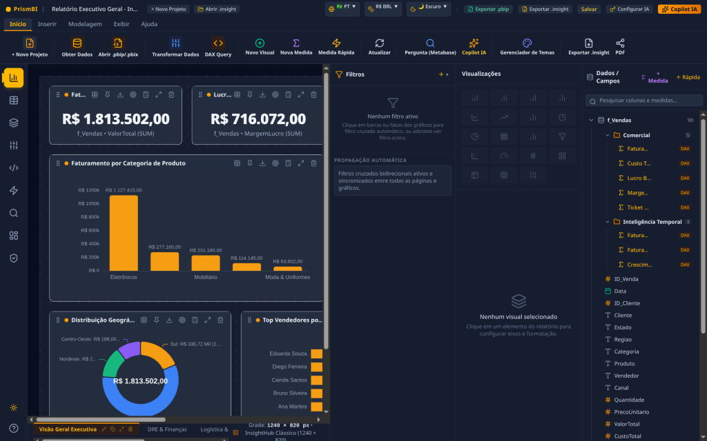
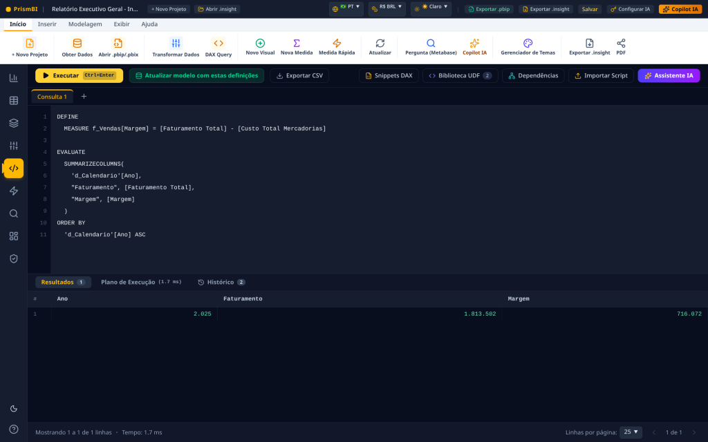

<div align="center">


# PrismBI

**Native Business Intelligence for Linux — lightweight, fast, and compatible with Power BI (`.pbip` / `.pbix`) projects**

🇺🇸 **English** • 🇧🇷 [Ler em Português](./README.pt-BR.md)

[](./package.json)
[](https://github.com/ludoviciphilip/PrismBI/actions/workflows/ci.yml)
[](https://github.com/ludoviciphilip/PrismBI/actions/workflows/release.yml)
[](https://tauri.app/)
[](./src-tauri)
[](https://duckdb.org/)
[](./LICENSE.md)

[Key Features](#-key-features) • [Visual Preview](#-visual-preview) • [Compatibility](./docs/COMPATIBILITY.md) • [Architecture](#-architecture) • [Installation & Running](#-installation--running) • [Contributing](./CONTRIBUTING.md) • [Roadmap](./ROADMAP.md)

</div>

---

**PrismBI** was built to solve one of the biggest daily bottlenecks for Linux users: analyzing semantic models, reports, and dashboards with the same fluidity and familiarity as **Power BI Desktop**, without relying on heavy Windows virtual machines.

Powered by **Tauri v2 + Rust + DuckDB** on the backend and **React + TypeScript + Apache ECharts** on the frontend, it delivers fast startup, low memory usage, and native GTK/WebKitGTK performance.

---

## 📸 Visual Preview

### Report View (Dark Mode & Light Mode)

| Dark Mode | Light Mode |
| :---: | :---: |
|  |  |

### Semantic Model (Star Schema) & DAX Queries

| Semantic Model & Relationships | DAX Query Studio |
| :---: | :---: |
|  |  |

---

## ✨ Key Features

### 📂 Power BI Compatibility (`.pbip` / `.pbix`)
- **Native Rust Import:** direct reading of `.pbip` folders (`*.SemanticModel` in **TMDL** format + `*.Report` in **PBIR** format) and `.pbix` files (`DataModelSchema`, UTF-16LE `Report/Layout`, and multi-query `DataMashup` extraction).
- **`.pbip` Round-Trip (`v0.6.0`):** export preserving Power Query (`M`) scripts, `columnCount` in multi-row cards, `advancedSlicerVisual` (`tiles`), `textbox`, `actionButton`, titles, page/visual `filterConfig`, and themes (`PrismTheme.json`), alongside `.insight` snapshots and PDF export.
- **PBIR Fidelity:** accurate resolution of renamed measures (`field.*.Property`), multi-row card grids, page/visual filters, date hierarchies, action buttons, and rich textboxes.

### 📊 Interactive Visuals Catalog
- **Cards & KPIs:** single KPI Card and Multi-Row Card (`cardVisual`) with dynamic grid (`columnCount`), compact number formatting (`K`, `M`, `B` / `Mil`, `Mi`, `Bi`), and positive/negative conditional coloring.
- **Analytical Charts (Apache ECharts):** Column, Stacked Column, Bar, Stacked Bar, Line, Area, Combo (Column + Line), Treemap, Scatter, and Gauge.
- **Pie & Donut:** formatted total displayed at the donut center, external labels with values and percentages, and instant tooltips.
- **Power BI-Style Funnel & Waterfall:** Funnel with readable `minSize`, `100%` top stage, and footer conversion rate; true Waterfall with positive/negative variations crossing zero, dashed connector lines, and final `Total` column.
- **Tables, Matrices & Slicers:** Pivot Matrix with row/column subtotals, interactive Table with Drill-Through, and Slicers supporting dropdown lists and clickable `tiles` mode.

### ⚡ Rust + DuckDB Analytical Engine (`v0.8.0`)
- **Embedded DuckDB:** fast native ingestion of **Excel (`.xlsx`/`.xls`)**, **CSV**, **Parquet**, **JSON**, and **REST API (JSON)** endpoints, plus a built-in native SQL console.
- **Real Data Refresh & Table Management:** **Refresh Data** reloads linked files/sources without losing visuals, measures, or relationships — including mapping differently named Excel sheets (e.g., sheet `Fato` → table `fLançamentos`), replacing table data from another workbook, and full table renaming.
- **Power Query (`M`) & Linux Path Remapping:** automatic Windows → Linux file path resolution inside `.pbip` projects and support for `Table.RenameColumns`, `Table.RemoveColumns`, `Table.SelectColumns`, and `Table.SelectRows`.
- **Measured DAX conformance: 364/368 (98.9%) in the native Rust engine** on an [independently verified corpus](./docs/DAX_CONFORMANCE.md) of 368 cases (expected values computed by Python oracles, run on every CI build). **Typed Rust engine (165+ functions),** about 3× faster than v0.7 on a 200k-row benchmark: native evaluation of `CALCULATE`, `SWITCH`, `RANKX`, `TREATAS`, `CONTAINSROW`, `GENERATESERIES`, `COALESCE`, `CONVERT`, `IS*` family, bit-shifts, math/trigonometry, text (`FORMAT`, `MID`, `FIND`, `SEARCH`, `SUBSTITUTE`, `CONTAINSSTRING`), statistics & iterators (`MEDIAN`, `PERCENTILE.*`, `STDEV.*`, `VAR.*`, `CONCATENATEX`), relationships (`VALUES`, `DISTINCT`, `TOPN`, `LOOKUPVALUE`, `USERELATIONSHIP`, `CROSSFILTER`), financial functions (`PMT`, `PV`, `FV`, `NPER`, `NPV`, `IPMT`, `PPMT`, `SLN`, `SYD`, `DB`, `DDB`, `EFFECT`, `NOMINAL`, `RATE`), `PATH*`, and full Time Intelligence (`TOTALYTD`, `TOTALQTD`, `TOTALMTD`, `PARALLELPERIOD`, `DATESBETWEEN`, `DATESINPERIOD`, `FIRSTNONBLANK`/`LASTNONBLANK`, `OPENINGBALANCE*`/`CLOSINGBALANCE*`), plus 60+ `INFO.*` DMVs in the TS engine. See the full [Compatibility Matrix](./docs/COMPATIBILITY.md).
- **Interactive Analysis:** bidirectional cross-filtering on click, 2-level expandable Matrix hierarchies, cross-page Drill-Through, Visual Calculations, and live telemetry in the Performance Analyzer.

### 🗄️ Native Database Connectors (`v0.8.0`)
- **PostgreSQL, MySQL/MariaDB, SQLite, `.duckdb` files and partitioned Parquet (local / HTTP / S3)** through DuckDB extensions (`ATTACH … READ_ONLY`), with no external gateway. PostgreSQL 16 and MariaDB 11 are tested against real servers in CI.
- **Schema/table navigator, preview, and SQL editor** that runs inside the connected database; tables loaded from a database are reloaded by **Refresh Data**.
- **Credentials in the Linux keyring** (Secret Service): never stored in `.insight`/`.pbip` files or `localStorage` (the Gemini API key is migrated too).

### 🔐 Security (`v0.8.0`)
- **Signed updates:** the auto-updater only installs packages whose `SHA256SUMS.txt` carries a valid Ed25519 signature from the key embedded in the app; download URLs are restricted to this repository's releases. `.deb`/`.rpm` installs get the right package; AUR/Flatpak installs are pointed to their package manager.
- **Content Security Policy** enabled in the Tauri webview.

### 🛠️ Productivity, Welcome Screen & Linux Distribution
- **Welcome Screen & In-App Auto-Updater:** start a blank model or open `.pbip`, `.pbix`, `.insight`, and recent sessions at launch, with a built-in **GitHub Releases auto-updater** and SHA-256 verification (in-place replacement for **AppImage**, direct download for `.deb`/`.rpm`).
- **GitHub Actions CI/CD:** automated Linux release builds (**AppImage**, **`.deb`**, **`.rpm`**) plus packaging manifests in `packaging/` for **AUR (`prismbi-bin`)** and **Flatpak**.
- **Pro Canvas Editing:** **Undo / Redo** (`Ctrl+Z`, `Ctrl+Y`, and Ribbon controls), **multi-select** (`Shift`/`Ctrl` + click, group drag, arrow-key nudge, `Delete`, and floating alignment/distribution toolbar), and **60fps Smart Snap Guides**.
- **Data & Model Views:** tabular data inspector, relationship manager with auto-detection, and Calendar Table generator.
- **Power Query / ETL, Quick Measures & UDF Library:** no-code data transformations, quick measure wizard, and DAX editor with IntelliSense.
- **Governance & Theming:** RLS/OLS simulation, What-If parameters, light/dark theme manager, multi-language UI (`EN`, `PT`, `ES`), and currency formatting (`USD`, `BRL`, `EUR`).
- **Canvas Shortcuts:** smooth zooming via `Ctrl + =`, `Ctrl + -`, `Ctrl + 0`, and `Ctrl + Scroll`, middle-mouse hold-and-drag panning across both Report Canvas and Semantic Model view, and `Esc` to exit Presentation Mode.

---

## 🏗️ Architecture

| Layer | Technology | Responsibility |
| :--- | :--- | :--- |
| **Desktop Shell** | Tauri v2 (GTK / WebKitGTK) | Lightweight native Linux window and system file dialogs |
| **Core Backend** | Rust (`src-tauri/`) | `.pbip`/`.pbix`/TMDL/PBIR parsers, M loader, and native DAX engine |
| **Columnar / SQL Engine** | DuckDB (`bundled` + `parquet` + `json`) | Native ingestion of `.xlsx`/`.csv`/`.parquet`/`.json`, storage, and SQL |
| **Frontend & Canvas** | React 19 + TypeScript + Tailwind v4 + Zustand | Power BI-style Ribbon, fields/filters panes, multi-page report canvas |
| **Visualization** | Apache ECharts 6 + Lucide | Responsive interactive charts across light and dark modes |

---

## 🚀 Installation & Running

### Pre-built Linux Packages
Download the latest **AppImage**, **`.deb`**, or **`.rpm`** directly from [GitHub Releases](https://github.com/ludoviciphilip/PrismBI/releases).

### Building from Source (Linux)

#### Prerequisites
- **Node.js** + **pnpm**
- **Rust** (`rustup` / `cargo`)
- Tauri v2 Linux system dependencies (`webkit2gtk-4.1`, `libgtk-3-dev`, `librsvg2-dev`, etc. — see the [official Tauri guide](https://v2.tauri.app/start/prerequisites/#linux)).

#### Development

```bash
pnpm install
pnpm tauri dev
```

#### Production Build (AppImage / `.deb` / `.rpm` / binary)

```bash
pnpm tauri build
```

---

## 🐧 Linux NVIDIA + Wayland Tips

By default, PrismBI uses WebKitGTK hardware acceleration (DMA-BUF) for smooth canvas rendering. If you run proprietary NVIDIA drivers on Wayland and see a blank window or explicit sync errors on launch, start PrismBI with:

```bash
__NV_DISABLE_EXPLICIT_SYNC=1 pnpm tauri dev
```

Or fall back to XWayland or software DMA-BUF rendering:

```bash
GDK_BACKEND=x11 pnpm tauri dev
# or:
WEBKIT_DISABLE_DMABUF_RENDERER=1 pnpm tauri dev
```

**AppImage and system WebKitGTK:** the AppImage automatically uses the system `webkit2gtk-4.1` when it is compatible (much smoother canvas than the older bundled one). Force the bundled engine with `PRISMBI_USE_BUNDLED_WEBKIT=1 ./PrismBI.AppImage`. On Arch, prefer the AUR package `prismbi-bin`, which always uses the system WebKitGTK.

---

## 🗺️ Roadmap & License

- Check upcoming milestones (`v0.8.0` to `v1.0.0`) in [ROADMAP.md](./ROADMAP.md).
- Distributed under [The Mutualist License v1.3](./LICENSE.md) — originally inspired by the UI and DAX engine of [InsightHub](https://github.com/ludoviciphilip/Insight-Hub).
