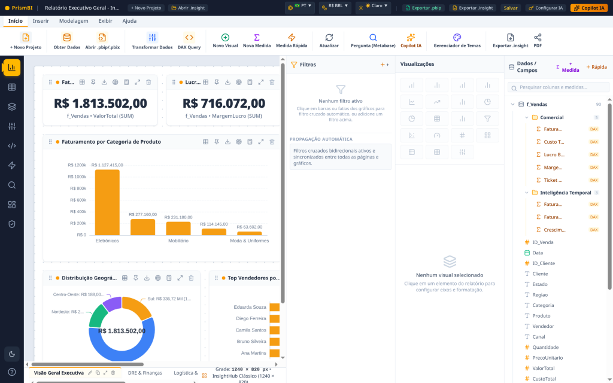
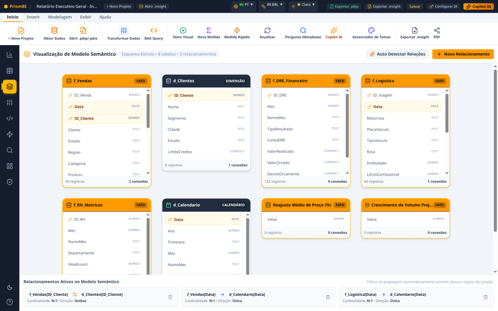

<div align="center">

# PrismBI

**Business Intelligence nativo para Linux — leve, rápido e compatível com projetos Power BI (`.pbip` / `.pbix`)**

[](./package.json)
[](https://tauri.app/)
[](./src-tauri)
[](https://duckdb.org/)
[](./LICENSE.md)

[Funcionalidades](#-principais-funcionalidades) • [Prévia Visual](#-prévia-visual) • [Arquitetura](#-arquitetura) • [Como Executar](#-como-executar) • [Roadmap](./ROADMAP.md)

</div>

---

O **PrismBI** nasceu para resolver um dos maiores gargalos de quem usa Linux no dia a dia: analisar modelos semânticos, relatórios e dashboards com a mesma fluidez e familiaridade do **Power BI Desktop**, sem depender de máquinas virtuais Windows pesadas.

Construído com **Tauri v2 + Rust + DuckDB** no backend e **React + TypeScript + Apache ECharts** na interface, ele entrega inicialização rápida, baixo consumo de RAM e execução nativa em GTK/WebKitGTK.

---

## 📸 Prévia Visual

### Visão de Relatório (Modo Escuro & Modo Claro)

| Modo Escuro | Modo Claro |
| :---: | :---: |
|  |  |

### Modelo Semântico (Esquema Estrela) & Consultas DAX

| Modelo Semântico & Relacionamentos | Estúdio de Consultas DAX |
| :---: | :---: |
|  |  |

---

## ✨ Principais Funcionalidades

### 📂 Compatibilidade com Power BI (`.pbip` / `.pbix`)
- **Importação nativa em Rust:** leitura direta de pastas `.pbip` (`*.SemanticModel` em formato **TMDL** + `*.Report` em formato **PBIR**) e arquivos `.pbix` (`DataModelSchema`, `Report/Layout` UTF-16LE e `DataMashup`).
- **Exportação `.pbip`:** salve projetos criados no PrismBI em estrutura compatível com TMDL/PBIR (`Exportar .pbip`), além de snapshots `.insight` e PDF.
- **Fidelidade PBIR:** resolução correta de medidas renomeadas (`field.*.Property`), `columnCount` em cartões múltiplos, `filterConfig` em páginas/visuais, hierarquias de data, botões de ação (`actionButton`) e caixas de texto (`textbox`).

### 📊 Catálogo de Visuais Interativos
- **Cartões & KPIs:** Cartão KPI simples e Cartão Múltiplo (`cardVisual`) com grade dinâmica (`columnCount`), unidades compactas (`Mil`, `Mi`, `Bi`) e coloração condicional por sinal positivo/negativo.
- **Gráficos Analíticos (Apache ECharts):** Colunas, Colunas Empilhadas, Barras, Barras Empilhadas, Linhas, Área, Combinado (Coluna + Linha), Treemap, Dispersão e Medidor (Gauge).
- **Pizza & Rosca:** total formatado exibido no centro da rosca, rótulos externos com valor e percentual e tooltips instantâneos.
- **Funil & Cascata estilo Power BI:** Funil com `minSize` legível, topo `100%` e taxa de conversão no rodapé; Cascata real com variações positivas/negativas cruzando zero, linhas tracejadas conectoras e coluna `Total` final.
- **Tabelas, Matrizes & Segmentadores:** Matriz Pivot com totais por linha/coluna, Tabela interativa com Drill-Through e Segmentadores no modo lista suspensa (`dropdown`) ou blocos clicáveis (`tiles`).

### ⚡ Motor Analítico em Rust + DuckDB
- **DuckDB embarcado:** ingestão nativa rápida de planilhas **Excel (`.xlsx`)** e **CSV**, além de console SQL nativo.
- **Motor DAX em Rust:** avaliação de medidas com `CALCULATE`, `SWITCH`, variáveis (`VAR` / `RETURN`), medidas encadeadas e propagação automática de filtros pelos relacionamentos (`1:N`, `N:1`, direção única e bidirecional).
- **Análise Interativa:** Cross-filtering bidirecional ao clicar em qualquer visual, Drill-Through entre páginas, Cálculos Visuais (`RUNNINGSUM` etc.) e cache inteligente de consultas por visual.

### 🛠️ Produtividade, Modelagem & Governança
- **Visualização de Dados & Modelo:** inspeção tabular, gerenciador de relacionamentos com autodetecção e suporte a Tabelas Calendário.
- **Power Query / ETL, Medidas Rápidas & Biblioteca UDF:** transformações de dados, assistente de medidas rápidas e editor DAX com IntelliSense.
- **Governança & Temas:** simulação de RLS/OLS, parâmetros What-If, gerenciador de temas claros/escuros e suporte a i18n (`PT`, `EN`, `ES`) e moedas (`BRL`, `USD`, `EUR`).
- **Atalhos de Canvas:** zoom fluido com `Ctrl + =`, `Ctrl + -`, `Ctrl + 0` e `Ctrl + Scroll` do mouse, além de arraste/redimensionamento a 60fps.

---

## 🏗️ Arquitetura

| Camada | Tecnologia | Responsabilidade |
| :--- | :--- | :--- |
| **Desktop Shell** | Tauri v2 (GTK / WebKitGTK) | Janela nativa leve para Linux e diálogos de arquivos do sistema |
| **Core Backend** | Rust (`src-tauri/`) | Parsers `.pbip`/`.pbix`/TMDL/PBIR, carregador M e motor DAX nativo |
| **Motor Colunar / SQL** | DuckDB (`bundled`) | Leitura rápida de `.xlsx`/`.csv`, armazenamento em memória e SQL |
| **Frontend & Canvas** | React 19 + TypeScript + Tailwind v4 + Zustand | Ribbon estilo Power BI, painéis de campos/filtros, canvas multi-página |
| **Visualização** | Apache ECharts 6 + Lucide | Gráficos interativos responsivos em tema claro e escuro |

---

## 🚀 Como Executar

### Pré-requisitos (Linux)
- **Node.js** + **pnpm**
- **Rust** (`rustup` / `cargo`)
- Dependências de sistema do Tauri v2 (`webkit2gtk-4.1`, `libgtk-3-dev`, `librsvg2-dev`, etc. — consulte o [guia oficial do Tauri](https://v2.tauri.app/start/prerequisites/#linux)).

### Desenvolvimento

```bash
pnpm install
pnpm tauri dev
```

### Build de Produção (AppImage / `.deb` / `.rpm` / binário)

```bash
pnpm tauri build
```

---

## 🐧 Dicas para GPU NVIDIA + Wayland no Linux

Por padrão, o PrismBI utiliza aceleração por hardware (DMA-BUF) do WebKitGTK para manter o canvas fluido. Caso seu ambiente utilize drivers proprietários NVIDIA no Wayland e apresente tela branca ou falha de sincronização ao abrir a janela nativa, tente iniciar com:

```bash
__NV_DISABLE_EXPLICIT_SYNC=1 pnpm tauri dev
```

Ou, em último caso, via XWayland ou renderização por software:

```bash
GDK_BACKEND=x11 pnpm tauri dev
# ou:
WEBKIT_DISABLE_DMABUF_RENDERER=1 pnpm tauri dev
```

---

## 🗺️ Roadmap & Licença

- Veja as próximas entregas (`v0.4.0` a `v1.0.0`) em [ROADMAP.md](./ROADMAP.md).
- Distribuído sob [The Mutualist License v1.3](./LICENSE.md) — originalmente inspirado na UI e engine DAX do [InsightHub](https://github.com/ludoviciphilip/Insight-Hub).
