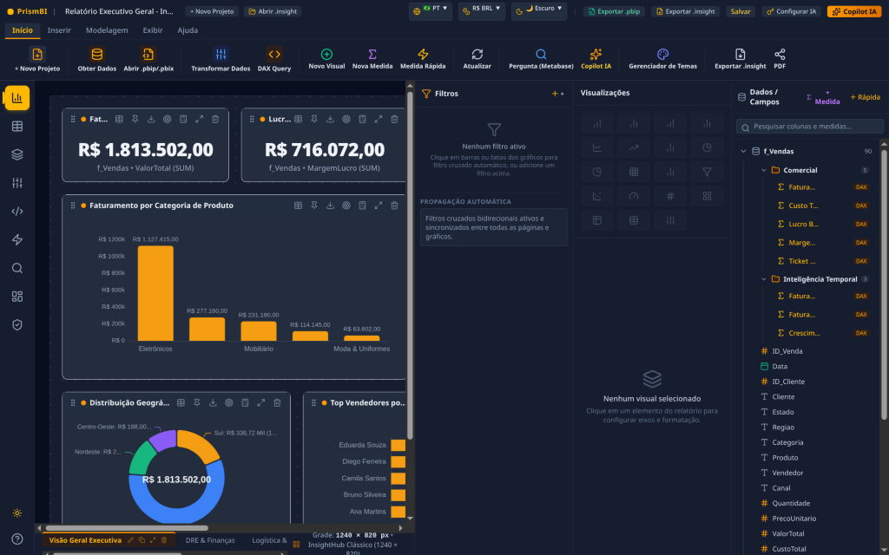
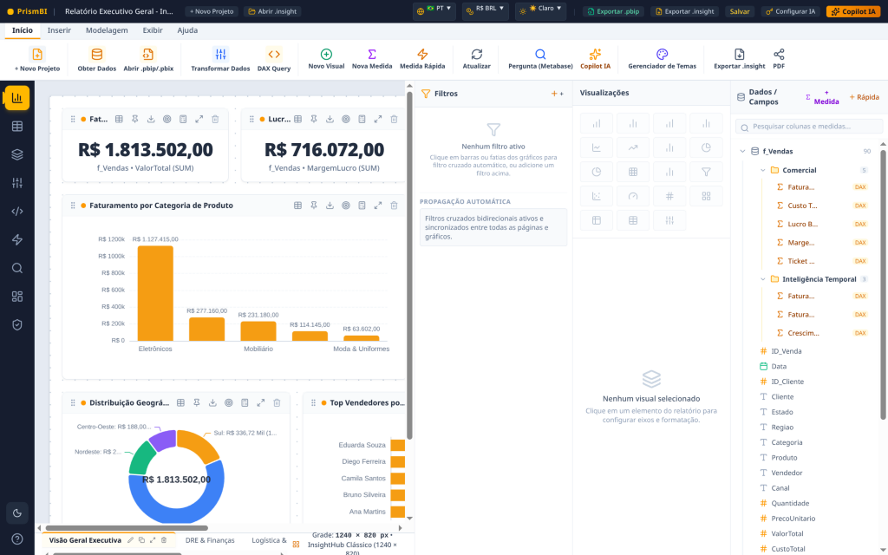
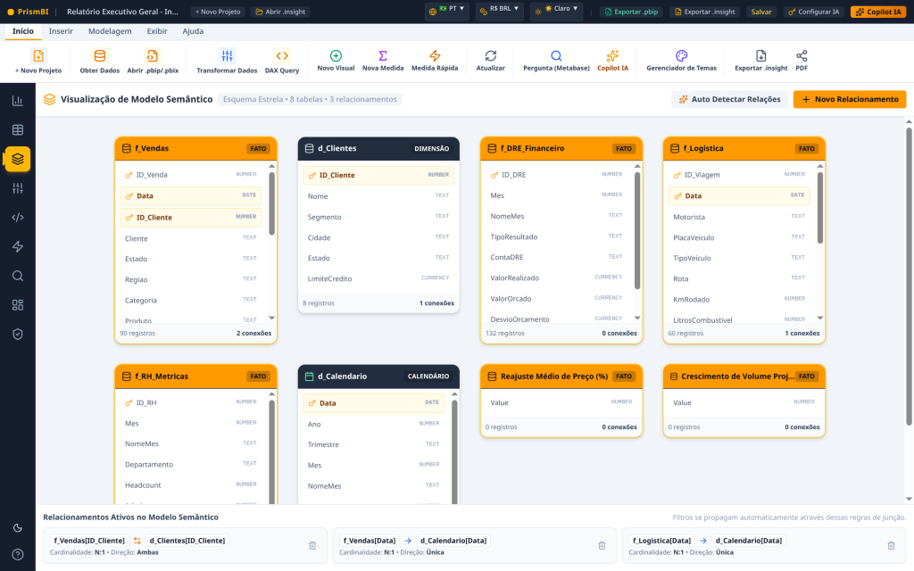
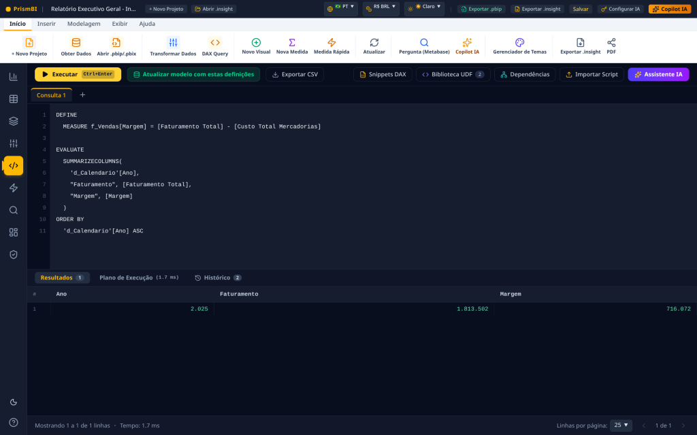

<div align="center">


# PrismBI

**Business Intelligence nativo para Linux — leve, rápido e compatível com projetos Power BI (`.pbip` / `.pbix`)**

🇺🇸 [Read in English](./README.md) • 🇧🇷 **Português (Brasil)**

[](./package.json)
[](https://github.com/ludoviciphilip/PrismBI/actions/workflows/ci.yml)
[](https://github.com/ludoviciphilip/PrismBI/actions/workflows/release.yml)
[](https://tauri.app/)
[](./src-tauri)
[](https://duckdb.org/)
[](./LICENSE.md)

[Funcionalidades](#-principais-funcionalidades) • [Prévia Visual](#-prévia-visual) • [Compatibilidade](./docs/COMPATIBILITY.md) • [Arquitetura](#-arquitetura) • [Como Executar](#-como-executar) • [Contribuindo](./CONTRIBUTING.md) • [Roadmap](./ROADMAP.md)

</div>

---

O **PrismBI** nasceu para resolver um dos maiores gargalos de quem usa Linux no dia a dia: analisar modelos semânticos, relatórios e dashboards com a mesma fluidez e familiaridade do **Power BI Desktop**, sem depender de máquinas virtuais Windows pesadas.

Construído com **Tauri v2 + Rust + DuckDB** no backend e **React + TypeScript + Apache ECharts** na interface, ele entrega inicialização rápida, baixo consumo de RAM e execução nativa em GTK/WebKitGTK.

---

## 📸 Prévia Visual

### Visão de Relatório (Modo Escuro & Modo Claro)

| Modo Escuro | Modo Claro |
| :---: | :---: |
|  |  |

### Modelo Semântico (Esquema Estrela) & Consultas DAX

| Modelo Semântico & Relacionamentos | Estúdio de Consultas DAX |
| :---: | :---: |
|  |  |

---

## ✨ Principais Funcionalidades

### 📂 Compatibilidade com Power BI (`.pbip` / `.pbix`)
- **Importação nativa em Rust:** leitura direta de pastas `.pbip` (`*.SemanticModel` em formato **TMDL** + `*.Report` em formato **PBIR**) e arquivos `.pbix` (`DataModelSchema`, `Report/Layout` UTF-16LE e extração multi-query do `DataMashup`).
- **Round-Trip `.pbip` (`v0.6.0`):** exportação preservando scripts Power Query (M), `columnCount` em cartões múltiplos, `advancedSlicerVisual` (`tiles`), `textbox`, `actionButton`, títulos, `filterConfig` em páginas/visuais e temas (`PrismTheme.json`), além de snapshots `.insight` e PDF.
- **Fidelidade PBIR:** resolução correta de medidas renomeadas (`field.*.Property`), `columnCount` em cartões múltiplos, `filterConfig` em páginas/visuais, hierarquias de data, botões de ação (`actionButton`) e caixas de texto (`textbox`).

### 📊 Catálogo de Visuais Interativos
- **Cartões & KPIs:** Cartão KPI simples e Cartão Múltiplo (`cardVisual`) com grade dinâmica (`columnCount`), unidades compactas (`Mil`, `Mi`, `Bi`) e coloração condicional por sinal positivo/negativo.
- **Gráficos Analíticos (Apache ECharts):** Colunas, Colunas Empilhadas, Barras, Barras Empilhadas, Linhas, Área, Combinado (Coluna + Linha), Treemap, Dispersão e Medidor (Gauge).
- **Pizza & Rosca:** total formatado exibido no centro da rosca, rótulos externos com valor e percentual e tooltips instantâneos.
- **Funil & Cascata estilo Power BI:** Funil com `minSize` legível, topo `100%` e taxa de conversão no rodapé; Cascata real com variações positivas/negativas cruzando zero, linhas tracejadas conectoras e coluna `Total` final.
- **Tabelas, Matrizes & Segmentadores:** Matriz Pivot com totais por linha/coluna, Tabela interativa com Drill-Through e Segmentadores no modo lista suspensa (`dropdown`) ou blocos clicáveis (`tiles`).

### ⚡ Motor Analítico em Rust + DuckDB (`v0.8.0`)
- **DuckDB embarcado:** ingestão nativa rápida de **Excel (`.xlsx`/`.xls`)**, **CSV**, **Parquet**, **JSON** e endpoints **API REST (JSON)**, além de console SQL nativo.
- **Atualização Real & Gestão de Tabelas:** botão **Atualizar Dados** que recarrega arquivos/fontes vinculados sem perder visuais, medidas ou relacionamentos — incluindo mapeamento de abas com nomes diferentes (ex.: aba `Fato` → `fLançamentos`), substituição de dados por outra planilha e renomeação completa de tabelas.
- **Power Query (M) & Remapeamento Linux:** resolução automática de caminhos Windows → Linux em `.pbip` e suporte a `Table.RenameColumns`, `Table.RemoveColumns`, `Table.SelectColumns` e `Table.SelectRows`.
- **Conformidade DAX medida: 364/368 (98,9%) no motor Rust nativo,** num [corpus verificado de forma independente](./docs/DAX_CONFORMANCE.md) de 368 casos (valores esperados calculados por oráculos em Python, executado em todo build do CI). **Motor Rust tipado (+165 funções),** cerca de 3× mais rápido que a v0.7 num benchmark de 200 mil linhas: avaliação nativa de `CALCULATE`, `SWITCH`, `RANKX`, `TREATAS`, `CONTAINSROW`, `GENERATESERIES`, `COALESCE`, `CONVERT`, família `IS*`, bit-shifts, matemática/trigonometria, texto (`FORMAT`, `MID`, `FIND`, `SEARCH`, `SUBSTITUTE`, `CONTAINSSTRING`), estatísticas/iteradores (`MEDIAN`, `PERCENTILE.*`, `STDEV.*`, `VAR.*`, `CONCATENATEX`), relacionamentos (`VALUES`, `DISTINCT`, `TOPN`, `LOOKUPVALUE`, `USERELATIONSHIP`, `CROSSFILTER`), financeiro (`PMT`, `PV`, `FV`, `NPER`, `NPV`, `IPMT`, `PPMT`, `SLN`, `SYD`, `DB`, `DDB`, `EFFECT`, `NOMINAL`, `RATE`), `PATH*` e Time Intelligence completo (`TOTALYTD`, `TOTALQTD`, `TOTALMTD`, `PARALLELPERIOD`, `DATESBETWEEN`, `DATESINPERIOD`, `FIRSTNONBLANK`/`LASTNONBLANK`, `OPENINGBALANCE*`/`CLOSINGBALANCE*`), além de 60+ DMVs `INFO.*` no motor TS. Veja a [Matriz de Compatibilidade](./docs/COMPATIBILITY.md).
- **Análise Interativa:** Cross-filtering bidirecional ao clicar em qualquer visual, Matriz com hierarquia expansível em 2 níveis, Drill-Through entre páginas, Cálculos Visuais e telemetria real no Performance Analyzer.

### 🗄️ Conectores Nativos de Banco de Dados (`v0.8.0`)
- **PostgreSQL, MySQL/MariaDB, SQLite, arquivos `.duckdb` e Parquet particionado (local / HTTP / S3)** via extensões do DuckDB (`ATTACH … READ_ONLY`), sem gateway externo. PostgreSQL 16 e MariaDB 11 testados contra servidores reais no CI.
- **Navegador de schemas e tabelas, pré-visualização e editor SQL** que roda dentro do banco conectado; tabelas carregadas de banco são recarregadas pelo **Atualizar Dados**.
- **Credenciais no chaveiro do Linux** (Secret Service): nunca em arquivos `.insight`/`.pbip` nem no `localStorage` (a chave do Gemini também migra).

### 🔐 Segurança (`v0.8.0`)
- **Atualizações assinadas:** o atualizador só instala pacotes cujo `SHA256SUMS.txt` tenha assinatura Ed25519 válida da chave embutida no app; downloads restritos às releases deste repositório. Instalações `.deb`/`.rpm` recebem o pacote certo; AUR/Flatpak são orientados ao gerenciador de pacotes.
- **Content Security Policy** ativa no webview do Tauri.

### 🛠️ Produtividade, Tela Inicial & Distribuição Linux
- **Tela Inicial (`WelcomeScreen`) & Auto-Updater:** escolha começar um projeto em branco ou abrir `.pbip`, `.pbix`, `.insight` e sessões recentes ao iniciar, com **atualizador integrado no app** via GitHub Releases e validação SHA-256 (in-place para **AppImage** e download direto para `.deb`/`.rpm`).
- **GitHub Actions CI/CD:** builds automáticas para Linux (**AppImage**, **`.deb`**, **`.rpm`**) além de manifestos em `packaging/` para **AUR (`prismbi-bin`)** e **Flatpak**.
- **Edição Profissional no Canvas:** **Undo / Redo** (`Ctrl+Z`, `Ctrl+Y` e botões na Ribbon), **seleção múltipla** (`Shift`/`Ctrl` + clique, arraste em grupo, nudge com setas, `Delete` e barra flutuante de alinhamento/distribuição) e **Smart Snap Guides** a 60fps.
- **Visualização de Dados & Modelo:** inspeção tabular, gerenciador de relacionamentos com autodetecção e suporte a Tabelas Calendário.
- **Power Query / ETL, Medidas Rápidas & Biblioteca UDF:** transformações de dados, assistente de medidas rápidas e editor DAX com IntelliSense.
- **Governança & Temas:** simulação de RLS/OLS, parâmetros What-If, gerenciador de temas claros/escuros e suporte a i18n (`PT`, `EN`, `ES`) e moedas (`BRL`, `USD`, `EUR`).
- **Atalhos de Canvas:** zoom fluido com `Ctrl + =`, `Ctrl + -`, `Ctrl + 0` e `Ctrl + Scroll`, além de movimentação livre no canvas e modelo mantendo o botão do scroll pressionado e `Esc` para sair do Modo Apresentação.

---

## 🏗️ Arquitetura

| Camada | Tecnologia | Responsabilidade |
| :--- | :--- | :--- |
| **Desktop Shell** | Tauri v2 (GTK / WebKitGTK) | Janela nativa leve para Linux e diálogos de arquivos do sistema |
| **Core Backend** | Rust (`src-tauri/`) | Parsers `.pbip`/`.pbix`/TMDL/PBIR, carregador M e motor DAX nativo |
| **Motor Colunar / SQL** | DuckDB (`bundled` + `parquet` + `json`) | Leitura nativa de `.xlsx`/`.csv`/`.parquet`/`.json`, armazenamento e SQL |
| **Frontend & Canvas** | React 19 + TypeScript + Tailwind v4 + Zustand | Ribbon estilo Power BI, painéis de campos/filtros, canvas multi-página |
| **Visualização** | Apache ECharts 6 + Lucide | Gráficos interativos responsivos em tema claro e escuro |

---

## 🚀 Como Executar

### Pré-requisitos (Linux)
- **Node.js** + **pnpm**
- **Rust** (`rustup` / `cargo`)
- Dependências de sistema do Tauri v2 (`webkit2gtk-4.1`, `libgtk-3-dev`, `librsvg2-dev`, etc. — consulte o [guia oficial do Tauri](https://v2.tauri.app/start/prerequisites/#linux)).

### Desenvolvimento

```bash
pnpm install
pnpm tauri dev
```

### Build de Produção (AppImage / `.deb` / `.rpm` / binário)

```bash
pnpm tauri build
```

---

## 🐧 Dicas para GPU NVIDIA + Wayland no Linux

Por padrão, o PrismBI utiliza aceleração por hardware (DMA-BUF) do WebKitGTK para manter o canvas fluido. Caso seu ambiente utilize drivers proprietários NVIDIA no Wayland e apresente tela branca ou falha de sincronização ao abrir a janela nativa, tente iniciar com:

```bash
__NV_DISABLE_EXPLICIT_SYNC=1 pnpm tauri dev
```

Ou, em último caso, via XWayland ou renderização por software:

```bash
GDK_BACKEND=x11 pnpm tauri dev
# ou:
WEBKIT_DISABLE_DMABUF_RENDERER=1 pnpm tauri dev
```

---

## 🗺️ Roadmap & Licença

- Veja as próximas entregas (`v0.8.0` a `v1.0.0`) em [ROADMAP.md](./ROADMAP.md).
- Distribuído sob [The Mutualist License v1.3](./LICENSE.md) — originalmente inspirado na UI e engine DAX do [InsightHub](https://github.com/ludoviciphilip/Insight-Hub).
